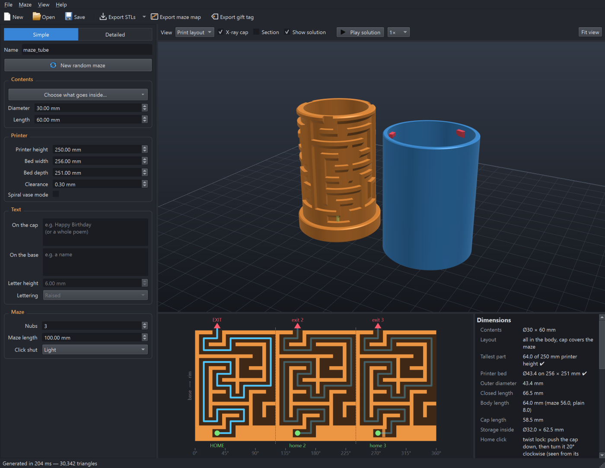
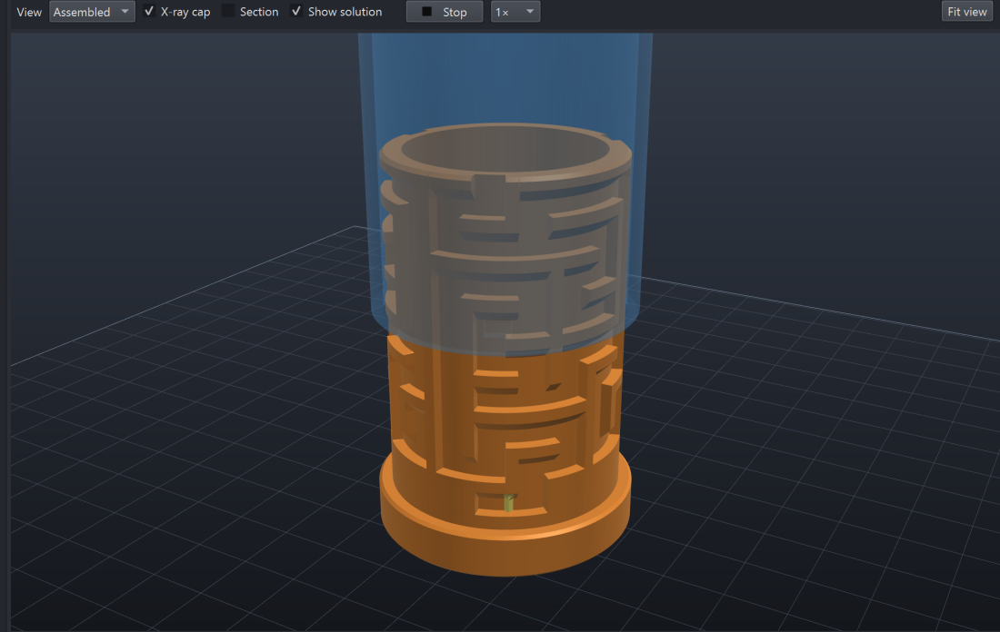
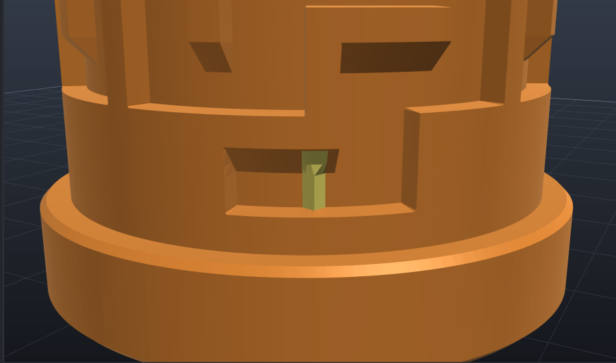
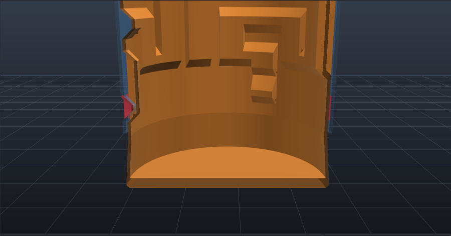
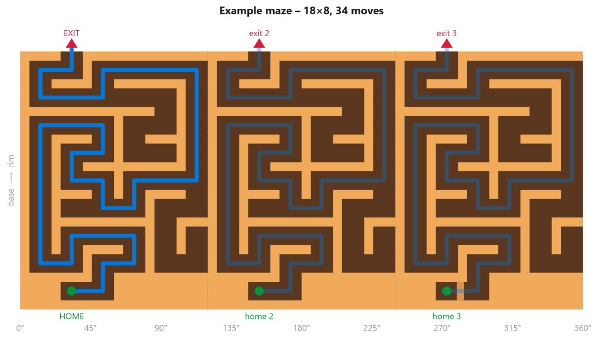
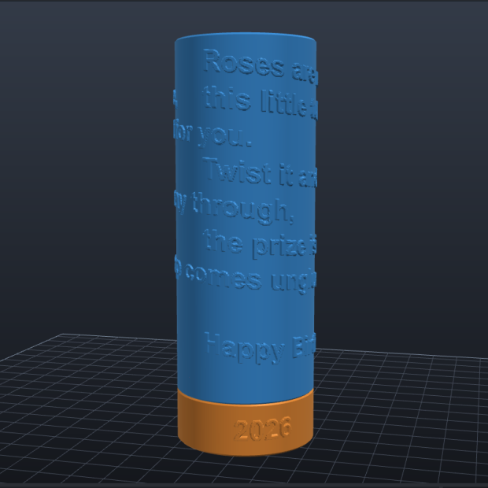
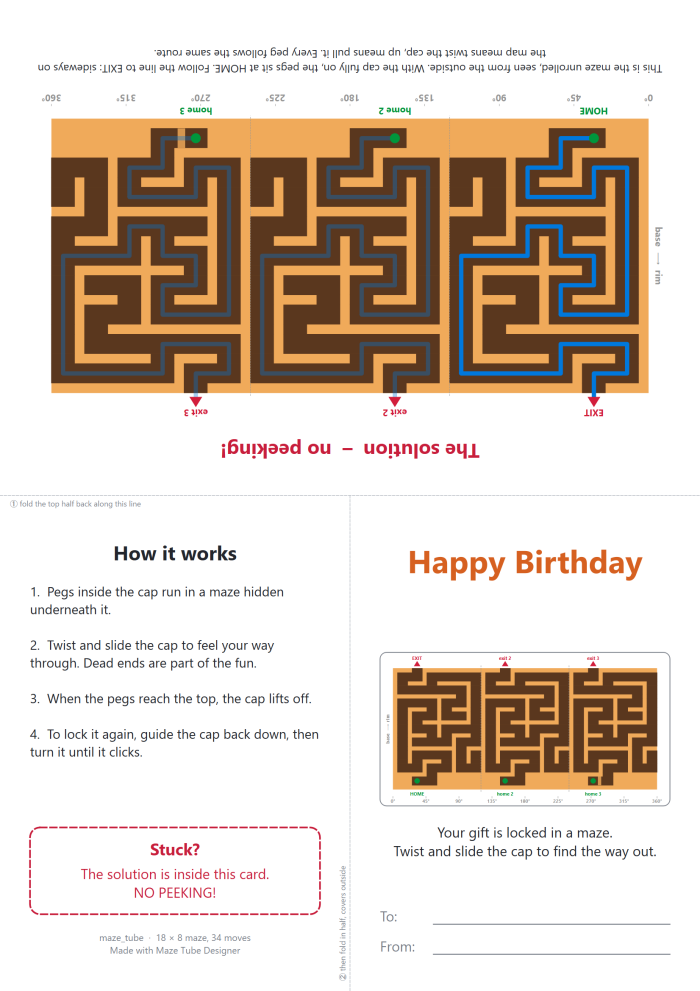
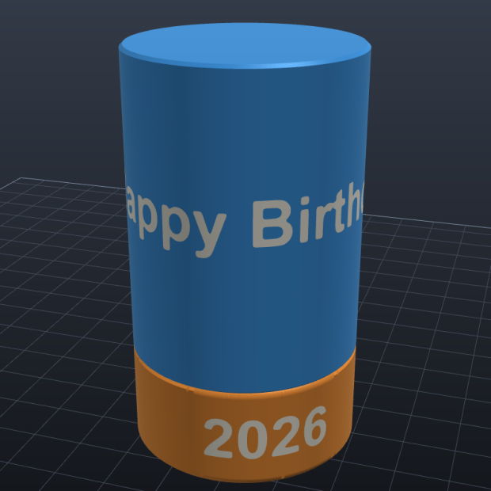
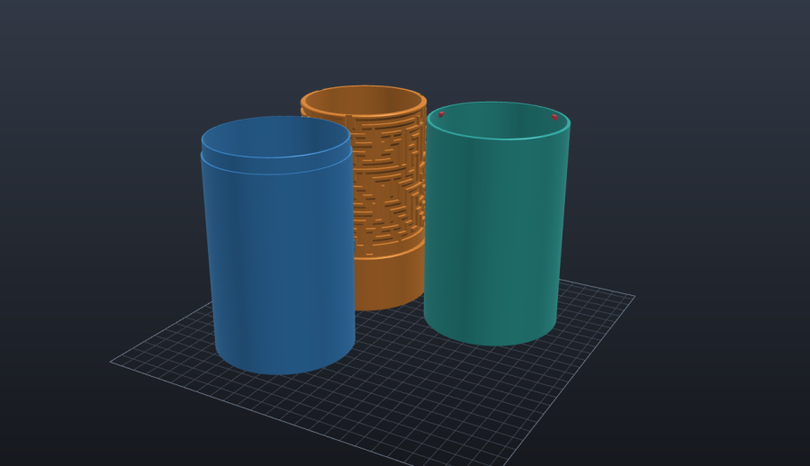
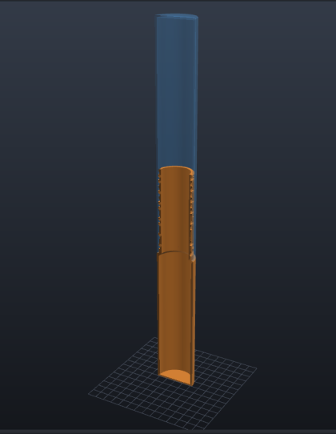

# Maze Tube Designer

A Windows desktop app that designs **3D-printable cylinder maze puzzle boxes**: a tube inside a tube.

* **Body** (inner tube, orange): a closed-bottom tube with a maze carved into its outer surface.
* **Cap** (outer tube, blue): slides over the body. Nubs on its inside ride in the maze grooves,
  so the cap comes off only after you guide it through the whole maze. The maze is hidden
  under the cap while you solve it.

The app makes the maze, shows both parts in 3D, animates the solution, and exports
watertight STL files that are already oriented for printing.



| Solution animation (X-ray cap) | Twist lock: the last move is a clockwise turn into a pocket |
|---|---|
|  |  |
| **Spiral vase mode: one continuous 0.6 mm wall** | **Printable maze map with the solution** |
|  |  |
| **Text: a poem spiralling round the cap** | **Gift tag: the solution folds inside** |
|  |  |

## Features

* Mazes on a wrapped cylinder grid, using recursive backtracker, Prim, Kruskal or Wilson. You can set
  the seed, add a sideways bias and add extra loops, and home and exit can be placed for the longest
  solution.
* Use 1–6 nubs; the maze repeats once per nub, so all the nubs move together.
* A **twist lock** holds the cap shut: push it down, then turn it clockwise until it clicks.
  Locked, it cannot be pulled off.
* **45° ceilings** let both parts print without supports.
* **Spiral vase mode** prints each part as one continuous wall.
* **Sized from the contents**: presets for bottles, cans, cash and more, kept within your printer's
  height. **Simple** and **Detailed** modes.
* **Text** on the cap and the base: raised, engraved, or flush in a **second colour** for
  multi-colour printers. Several lines are fine, and long text spirals round the tube, so a whole
  poem fits.
* **Three-piece tubes** (body, extension, cap) for contents too long for two printable parts.
* **Printer checks**: every piece is kept within the printer's height, and the tube is checked
  against the bed.
* **Long tubes**: set the body and cap lengths separately, so only part of the length is maze.
* Live 3D view (print layout, assembled, exploded, X-ray, section), solution animation, and an
  unrolled maze map that exports to PNG or SVG.
* An automatic **fit check** moves the nubs along the whole solution and confirms they clear the body.
* Exports: one **STL** per piece, a **3MF** with every piece as a separate object on one plate, the
  maze map, and a printable **gift tag** that hides the solution inside a fold.
* Designs save as `.mazetube` files (JSON with every parameter plus the exact maze).

## Download and run

* **Windows app (no Python needed):** download `MazeTubeDesigner.exe` from the
  [Releases](../../releases) page and run it. It is a single file: nothing to unzip or install.
  It isn't code-signed, so Windows SmartScreen may ask once; choose **More info → Run anyway**.
* **From source** (Python 3.10+, any OS with OpenGL):
  ```
  git clone https://github.com/RickUsingGitHub/maze-tube-designer.git
  cd maze-tube-designer
  python -m venv .venv
  .venv\Scripts\pip install -r requirements.txt      # macOS/Linux: .venv/bin/pip
  .venv\Scripts\python main.py
  ```
  On Windows you can also just double-click `run.bat`, which sets everything up on first run.
* **Build the Windows app yourself:** `build_exe.bat` (uses PyInstaller; the result is
  `dist\MazeTubeDesigner.exe`).

## Using it

The app starts in **Simple** mode. Say what goes inside and what your printer can do, and the tube is
worked out for you:

1. **Contents**: pick a preset from *Choose what goes inside…*, or type the diameter and length.
2. **Printer**: set the tallest part your printer can make, the bed size, the fit clearance, and
   whether you want spiral vase mode. These printer settings are remembered for next time.
3. **Text**: optional words for the cap and the base.
4. **Maze**: choose the number of nubs (3 by default) and the longest maze section you want.

The app sets the tube's diameter and the body, cap and maze lengths. Short contents sit entirely in the
body and the cap just covers the maze. Contents longer than one printable part are shared between body
and cap, and the maze overlap is shortened automatically so both parts fit the printer height.

Presets cover small gifts, cash (rolled or flat stacks in AUD, USD, EUR, GBP, NZD, CAD, JPY), drink cans
(250–500 ml), wine, champagne, beer and spirit bottles, rolled paper, and golf and tennis balls. The
sizes are typical; bottles in particular vary, so measure yours if the fit matters.

Switch to **Detailed** for every setting. Turning off *Size from contents* there lets you set the maze
diameter and the body and cap lengths yourself. The tube stays exactly as it was when you switch.

| Group | Key parameters (Detailed mode) |
|---|---|
| Contents | size from contents on/off, diameter, length, fit slack |
| Printer | printer height, bed width and depth, **clearance** (0.25–0.35 mm suits most FDM printers), spiral vase mode, line width |
| Text | cap text, base text, letter height, lettering (raised / engraved / second colour), depth |
| Maze | rows (or Auto = fill a **maze length**), columns (Auto fits the circumference), number of nubs (the maze repeats once per nub), path/wall width, algorithm, seed, sideways bias, extra loops, home notch, click shut |
| Body | maze diameter, groove depth, core wall, **body length**, grip band, plain wall, bottom thickness |
| Cap | wall, top thickness, **cap length**, pieces (automatic / two / three), joint length |
| Print & finish | 45° ceilings (prints with no supports), edge chamfer, grip flutes, facet size |

* **View:** Print layout / Assembled / Exploded / Body only / Cap only, with *X-ray cap* and *Section*.
  Left-drag rotates, right-drag (or Shift+drag) pans, the wheel zooms, and double-click or F refits the view.
* **Play solution (F5):** animates the cap through the maze and tracks the nubs on the map.
* **Maze map:** the unrolled maze as seen from outside, with HOME, EXIT and the solution.
  The map is cut where the solution doesn't cross, so the route never runs off one edge and back in at
  the other. A route that winds more than once round the tube gets a wider map (the maze repeats past
  360°). *Export maze map* saves it as PNG or SVG, e.g. as a printed solution card.
* **Save / Open:** `.mazetube` files (JSON) store every parameter plus the exact maze.
* **Export STLs (Ctrl+E):** writes one STL per piece (`name_body.stl`, `name_cap.stl`, plus
  `name_extension.stl` for three-piece tubes). The menu next to it also exports a single piece, a
  print-plate STL, or a **3MF** (Ctrl+Shift+E) with every piece as its own object, laid out on your bed.
  In Flash Studio, OrcaSlicer and Bambu Studio, load the 3MF with **File → Import** (Ctrl+I); see
  [Opening the 3MF in your slicer](#opening-the-3mf-in-your-slicer).
  Second-colour lettering is written as extra `_text.stl` files, and as a second part of each
  piece in the 3MF.
* **Export gift tag (Ctrl+G):** a PDF (or PNG) card to print on one sheet. Fold the top half back, then
  fold in half: the covers end up outside and the solution map inside, out of sight. The front has room
  for To and From, and uses the cap text as the greeting.

The panel on the right lists the dimensions, the solution length and any warnings. It also shows an
automatic **fit check**: the app moves the cap's nubs along the whole solution path and confirms they
never touch the body.

## Printing tips

* Print the body upright. Print the cap upside down, open end up (the exported cap is already flipped).
* **Slicer settings:** at least **3 wall loops**, **4–5 top layers**, 3–4 bottom layers and 15–20% infill.
  With 1 wall and 0 top layers (typical vase/draft profiles), the body's floor and the inside of the
  cap's end come out as open infill, and the maze ridges are hollow outlines.
* Leave *45° ceilings* on to print without supports. Use 0.2 mm layers or finer.
* If the fit is too tight, raise the clearance by 0.05 mm and print again. Test with a small, low design first.
* **Click shut** is a twist lock. There is one extra row below the maze. At the end of the maze the
  cap drops into it, and the last move is a **clockwise turn** (seen from the cap's closed end) into
  a pocket under solid wall.
  * Locked, the cap cannot be pulled off at all, however hard you pull. Turn it **anticlockwise**
    first; that is the puzzle's first move.
  * The landing is flat. Just before the nub comes to rest it passes one small **bump**: a thin
    line up the groove floor with 45° sides. That is the click, and it stops the cap turning back
    by itself.
  * Choose **Light, Medium or Firm**: the bump stands 0.40, 0.55 or 0.70 mm higher than the nub's
    clearance, which makes it 0.7, 0.85 or 1.0 mm high at the usual 0.3 mm clearance. Light was set
    from a test print, so start there. Detailed mode has **Click bump** to set it by hand.
  * There is one bump, not one per nub: a bump under every nub locks the rim solid. It is in the
    pocket nearest the front (the side the text is centred on) and is picked out in yellow in the
    3D view. The other pockets are plain.
  * The cap is stopped by the floor of the lock row, not by its rim on the body's shoulder (the
    shoulder sits 0.4 mm lower). However the two parts happen to seat, the nub has room to slide
    under the wall into its pocket. Closed, a hairline gap shows between cap and base.
  * **Off** leaves out the lock row. The cap then just drops into a **home notch**, which lets it
    close flush only at the home position.

## Text on the cap and base

Type into **On the cap** and **On the base**. Press Enter for a new line. The text reads upright when the
tube stands on its base, and the letters keep the height you set.

* **Lines that fit round the tube** are stacked and centred, each one level.
* **Anything longer spirals.** The whole text runs round and round the tube in one continuous line,
  dropping one line per turn. Each new line starts back at the same position on the next turn, and a
  blank line leaves a turn empty. A whole poem fits this way.
* **The part grows to hold the text.** Cap text makes the cap longer; base text makes the grip band
  below the maze taller. The maze keeps its rows.
* Letters are only made smaller when the printer height can't hold the text at full size, and the
  panel says so when that happens.
* Letters are raised 0.6 mm by default, with rounded edges so curves come out smooth. **Lettering**
  can also be *Engraved* (cut into the wall) or *Second colour, flush* (below). Detailed mode has
  the depth.
* In spiral vase mode the letters get 45° edges, and cap text is always raised (cutting in would use
  up the fit clearance).
* A long poem makes a detailed mesh (several hundred thousand triangles), so the design takes a
  second or so to rebuild after you stop typing.

### Text in a second colour



Set **Lettering** to *Second colour, flush* and the letters stop being bumps or dents: the wall stays
smooth, and each letter becomes a separate piece that fills a cut-out in it exactly. Give those
pieces another filament on a multi-colour printer (tool changer, IDEX or a filament-switching unit).

* **3MF (recommended):** each lettered piece opens as one object with two parts, the piece and its
  “text”. In Flash Studio and OrcaSlicer the text part arrives already set to **filament 2**; add
  a second filament if you only have one loaded. In other slicers, select the text part in the
  object list and give it your second filament.
* **STLs:** every lettered piece gets a second file ending in `_text.stl`. Load the pair together
  and answer *Yes* when the slicer asks whether to load them as one object with multiple parts.
  The two files share coordinates, so the letters land in their cut-outs.
* The letters go 0.8 mm deep (two printed walls), so the tube's colour doesn't show through. *Depth*
  in Detailed mode can make them deeper; a thin wall limits it.
* The printer changes filament on every layer the text crosses. Short text on one or two lines
  prints quickly; a poem spiralling down the cap means a change on most layers.
* Spiral vase mode prints one continuous wall, so it can't do a second colour: the text is raised
  there instead.

## Opening the 3MF in your slicer

The 3MF holds the shapes, their names and (for two-colour text) which filament each part uses. It
holds no printer, filament or process settings, so opening it never changes what you have set up.

* **Flash Studio, OrcaSlicer, Bambu Studio:** use **File → Import → Import 3MF/STL/…** (Ctrl+I), or
  drop the file onto a plate that already has something on it and choose *Import geometry only*.
* If you open it **as a project** instead (double-click, File → Open, or a drop onto an empty plate),
  some versions show a notice such as *“The 3MF file was generated by an old OrcaSlicer version,
  loading geometry data only.”* Flash Studio 1.7.19 does. The wording is misleading but the notice is
  harmless: it only means the file has no slicer settings in it. Click OK; the pieces load the same.
* Other slicers (PrusaSlicer, Cura) open it as ordinary objects.

## Three-piece tubes (body, extension, cap)



When the contents are too long for two parts on your printer, the cap is made in two pieces that glue
together: the **extension**, an open tube with the nubs that runs in the maze, and the **cap** end.

* **Pieces → Automatic** (the default) uses three pieces only when two would leave fewer than four maze
  rows. A wine bottle on a 160 mm printer becomes three 137 mm pieces with the full maze, where two
  pieces would leave a single row.
* The joint is a 10 mm overlap: a spigot on the cap end fits a socket in the extension with a glue gap.
  The socket is tapered inside so the extension prints joint-down without supports. Thin superglue
  works well.
* In spiral vase mode the cap end has a flared collar that slips over the extension. Slice the
  extension with 0 bottom layers, because it is an open tube.
* With explicit sizes, a cap taller than the printer height is split the same way.

## Printer bed

Set the bed width and depth with the printer height. The grid under the parts in the 3D view is the
bed at its real size (10 mm squares). The panel on the right shows whether the tube's
diameter fits the bed and warns when it doesn't (a magnum-sized tube on a small printer, say). The plate
STL and the 3MF arrange the pieces in rows to suit the bed, and the panel tells you when they won't all
fit at once.

## Long tubes (only part of the length is maze)

The maze always sits at the top of the body, where the cap slides on. Everything else can be plain tube:

* **Body length**: total body length. Everything below the maze section is plain tube.
* **Cap length**: total cap length. Anything longer than the maze runs past the body's rim and adds
  storage space inside the closed tube.
* **Rows → Auto + Maze length**: fits as many rows as possible into the length you give.
* **Plain wall**: a thinner wall for the plain part of the body (45° taper into the maze section, no
  supports), which saves a lot of filament on long tubes.



Example: body 250 mm, cap 250 mm, Rows Auto, maze length 100 mm gives a 95 mm maze (15 rows). It closes
to a 405 mm tube with about Ø33 × 400 mm of space inside. The panel on the right shows these figures.
Make sure the part lengths fit your printer's build height. The design is in
[examples/tall_tube_25cm.mazetube](examples/tall_tube_25cm.mazetube).

<br clear="right">


## Spiral vase (spiralize) printing

Turn on **Spiral vase mode** (in the *Spiral vase printing* group) to print both parts as one continuous
spiral wall. That's fast and uses very little filament. The design changes as follows:

* Every groove edge, the home notch floor and both faces of each nub become **45° slopes**, so each
  layer overlaps the one below. The tests check that no step anywhere is steeper than 45°.
* The parts are **exported solid** (file names end in `_vase`). The slicer prints only their outer skin.
  The cap's nubs are dents in its outer wall that push the thin wall inwards.
* The cap rim sits on a 45° shoulder instead of a flat ledge. Grip flutes are left off.
* Paths must be wider (at least 2 × groove depth + 2 × clearance + 0.6 mm). The app widens them
  automatically when you switch the mode on.
* In vase mode the 3D view shows the thin printed shells, so *Section* shows the real wall.

In the slicer: turn on Spiral vase / Spiralize. Set the **outer wall line width to the same value as
"Line width"** in the app (default 0.6 mm), because the cap's inner fit depends on it. Use about 1–2 mm
of bottom layers. Don't slice the `_vase` files normally: they would print as solid blocks.

## Project layout

```
mazetube/maze.py      maze generation on a wrapped grid, solver, statistics
mazetube/geometry.py  layout, radial height-map surfaces, watertight sweep meshes, fit check
mazetube/stl.py       binary STL writer
mazetube/viewer.py    OpenGL 3D viewer (PySide6 + PyOpenGL)
mazetube/mazeview.py  2D maze map
mazetube/app.py       main window
mazetube/params.py    design parameters + .mazetube save/load
mazetube/presets.py   contents presets (bottles, cans, cash, ...)
mazetube/textmask.py  text rendering and wrapping round the tube wall
mazetube/threemf.py   3MF writer
mazetube/gifttag.py   printable gift tag with the hidden solution
tests/                geometry self-tests:  python -m tests.test_geometry
examples/             ready-made designs (e.g. a 25 cm long tube, two-colour text, spiral vase)
```

### How the geometry works

Both mating surfaces are radial height maps r(θ, z). Each part is swept around the axis on a grid that
contains every break line. A step is modelled as two grid lines 0.05 mm apart, so every mesh stays a
plain deformed grid: closed, manifold and free of self-intersections, with no boolean operations.
The tests check this for many parameter sets. They also check that the cap clears the body along the
solution and that every closed maze wall really blocks the nub.

Second-colour lettering is the one place a mesh is cut. The grid cells the letter outlines pass
through are split along the outline (marching squares), the covered side is pushed in to form the
cut-out, and the letters are built from those same triangles, so they fill the cut-out exactly and
both meshes stay closed.

## License

MIT, see [LICENSE](LICENSE). STL files and puzzles you make with the app are yours to share or sell.

The Windows release bundles third-party libraries under their own licences: Qt / PySide6 (LGPLv3),
NumPy (BSD) and PyOpenGL (BSD).
